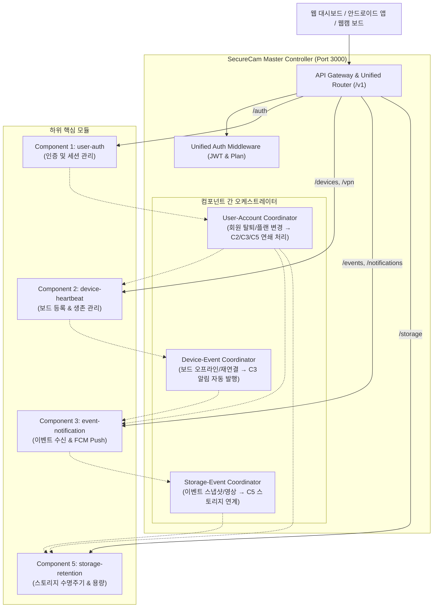

# SecureCam Integrated Controller (Master Controller & Coordinator)

> **통합 컨트롤러 모듈 (`SourceCode/controller`)**  
> **적용 기준:** `SPEC/Component.md`, `SPEC/ICD_v2.md`, `SPEC/FR/*`, `SPEC/NFR/*`  
> **목적:** 독립적으로 개발된 4개 핵심 백엔드 컴포넌트([C1] User-Auth, [C2] Device-Heartbeat, [C3] Event-Notification, [C5] Storage-Retention)를 단일 진입점(Gateway)으로 통합 마운트하고, 컴포넌트 간 비즈니스 흐름을 오케스트레이션(Orchestration)함.

---

## 1. 아키텍처 및 컴포넌트 연계 구조



---

## 2. 통합 라우팅 맵 (Routing Map)

| 엔드포인트 프리픽스 | 대상 컴포넌트 | 주요 제공 API | 인증 방식 |
| :--- | :--- | :--- | :--- |
| `/v1/auth`, `/auth` | **Component 1** (`user-auth`) | 회원가입, 로그인, 로그아웃, 비밀번호 재설정, 세션 관리 | Public / JWT |
| `/v1/devices`, `/devices` | **Component 2** (`device-heartbeat`) | 보드 프로비저닝, 보드 등록, 상태 조회, PTZ 제어, Heartbeat | JWT / MAC 인증 |
| `/v1/vpn`, `/vpn` | **Component 2** (`device-heartbeat`) | VPN 연결 상태 조회 및 수동 연결/끊기 제어 | JWT |
| `/v1/events`, `/events` | **Component 3** (`event-notification`) | 보드 이벤트 보고, 이벤트 목록 조회, 상태 처리, 일괄 확인 | JWT / Provision Token |
| `/v1/notifications`, `/notifications` | **Component 3** (`event-notification`) | 사용자별 알림 환경설정 조회 및 수정 | JWT |
| `/v1/storage`, `/storage` | **Component 5** (`storage-retention`) | 스토리지 사용량, 파일 목록, 다운로드, 파일 공유, 수명주기 | JWT / 서명 토큰 |
| `/health` | **통합 컨트롤러** | 4개 컴포넌트 통합 헬스체크 및 환경 상태 리포트 | Public |

---

## 3. 컴포넌트 간 오케스트레이션 (Inter-component Coordination)

1. **통합 인증 조율 (Unified Auth)**:
   - Component 1에서 발급한 표준 JWT 토큰을 Component 2, Component 3, Component 5가 일관되게 인식할 수 있도록 `unifiedAuthMiddleware`에서 사용자 식별자(`userId` / `user_id`) 및 플랜 정보를 표준화하여 주입합니다.
2. **기기 생존 ↔ 이벤트/알림 연계 (`DeviceEventCoordinator`)**:
   - Component 2에서 60초 무응답 등으로 보드 오프라인 감지 시, Component 3으로 `connection` 유형의 이벤트를 자동 전달하여 DB 저장 및 사용자 FCM 알림을 즉시 발송합니다.
3. **사용자 계정 ↔ 데이터 연쇄 정리 (`UserAccountCoordinator`)**:
   - Component 1에서 회원 탈퇴 시, 해당 사용자가 등록한 Component 2 보드의 소유권을 안전하게 해제하고, Component 3 알림 설정 및 Component 5 사용자 저장 파일을 연쇄적으로 정리합니다.
   - 사용자 구독 플랜(Basic, Standard, Premium)에 따라 Component 5의 클라우드 용량(5GB, 30GB, 100GB)과 파일 보존 기간(7일, 30일, 90일)을 동기화합니다.
4. **이벤트 미디어 ↔ 스토리지 수명주기 연동 (`StorageEventCoordinator`)**:
   - Component 3 이벤트에서 생성된 스냅샷(JPG) 및 녹화 클립(MP4)을 Component 5의 파일 메타데이터로 연계하여 사용량 계산 및 보존 기한 만료 시 자동 삭제를 수행합니다.

---

## 4. 설치 및 테스트

```bash
# 의존성 설치
npm install

# 전체 통합 테스트 실행 (단위, 라우팅, E2E 워크플로우, 오케스트레이션 검증)
npm test

# 서버 단독 실행 (기본 포트: 3000)
npm start
```

## WEB / VPN 인증 연동 (2026-11-05)

`/v1/vpn` 및 루트 호환 `/vpn` 경계에 C1 활성 세션 인증을 적용했습니다. 기존 C1 로그인 토큰으로 VPN 관리 API를 호출하며 로그아웃·강제 세션 만료가 반영됩니다. 개발용 `x-user-id`만으로 이 경계를 통과할 수 없습니다. C4 내부 인증도 Authorization 토큰을 개발용 헤더보다 우선합니다.

프론트엔드는 기본 `/v1` 프록시를 그대로 사용합니다. 독립 VPN 프로세스 연결 및 실제 API·브라우저 검증 방법은 `../WEB/README.md`를 참고합니다.
