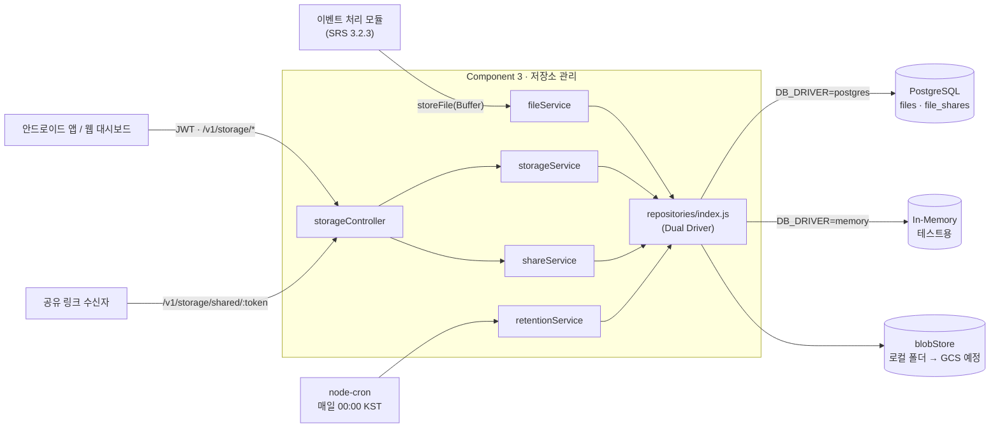

# SecureCam Component 3 — 저장소 관리 모듈

보안 WebCam 시스템(산학캡스톤, 산업 파트너 ㈜스마클) 클라우드 서버 중 **클라우드 저장소 관리(SRS 3.2.4)** 를 담당하는 Express 모듈.

| 항목 | 내용 |
| --- | --- |
| 담당 SRS | 3.2.4 저장소 관리 (SV-F-030 ~ SV-F-033) |
| 기준 문서 | SC-SRS-001 v1.0, SC-ICD-001 v1.0, Component.md v1.0, Component 2 README (팀 컨벤션) |
| 런타임 | Node.js 24 이상 (ESM) · Express 5 · PostgreSQL 17 |
| 의존 | Component 1 (JWT 인증, `users.plan`), Component 2 (`devices`) |
| 협력 | 이벤트 처리 모듈 (SRS 3.2.3) — 이벤트 스냅샷·클립을 `storeFile()`로 넘김 |
| 상태 | SV-F-030 ~ 033 구현 완료, 자동 테스트 12개 통과 (`npm test`) |

## 목차

1. [프로젝트 개요](#1-프로젝트-개요)
2. [요구사항 추적 매트릭스](#2-요구사항-추적-매트릭스)
3. [기술 스택](#3-기술-스택)
4. [디렉토리 구조](#4-디렉토리-구조)
5. [API 엔드포인트 명세](#5-api-엔드포인트-명세)
6. [로컬 실행 방법](#6-로컬-실행-방법)
7. [환경변수 (.env)](#7-환경변수-env)
8. [다른 컴포넌트 연동](#8-다른-컴포넌트-연동)
9. [임시본 · 미결 사항](#9-임시본--미결-사항)

---

## 1. 프로젝트 개요

클라우드 서버는 SRS 3.2 항목 단위로 나눠 개발한다. Component 3은 보드가 보낸 스냅샷(JPG)·영상 클립(MP4)이 클라우드에 저장된 **이후의 수명 전체** — 사용량 집계, 조회·다운로드·삭제·이름변경·공유, 플랜별 용량 제한, 보관 기간이 지난 파일 정리 — 를 맡는다.

| 모듈 | SRS | 범위 |
| --- | --- | --- |
| Component 1 | 3.2.1 | 사용자 인증 — 회원가입·로그인, JWT, 구독 플랜 |
| Component 2 | 3.2.2 | 보드 등록·생존 관리 — 프로비저닝, heartbeat |
| 이벤트 처리 모듈 | 3.2.3 | 이벤트 수신·상태 관리·FCM 알림 |
| **Component 3** | **3.2.4** | **저장소 관리 — 본 모듈** |

### 1.1 담당 기능

| 기능 | 요구사항 |
| --- | --- |
| 플랜 대비 클라우드 저장소 사용량 조회 (SUM 집계) | SV-F-030 |
| 파일 목록 · 다운로드(서명 URL) · 단건/다중 삭제 · 이름변경 · 공유 링크 | SV-F-031 |
| 플랜별 용량 차등: Basic 5 GiB / Standard 30 GiB / Premium 100 GiB | SV-F-032 |
| 보관 기간 경과 파일 자동 삭제: Basic 7일 / Standard 30일 / Premium 90일, 매일 00:00 KST | SV-F-033 |
| 이벤트 모듈이 파일을 넘기는 저장 창구 `storeFile()` (형식 검사 + 쿼터 검사) | SV-F-032, SV-F-024 연계 |

### 1.2 범위 밖

| 기능 | 담당 | 본 모듈과의 관계 |
| --- | --- | --- |
| 이벤트 수신·조회·확인 처리, FCM 알림 | 이벤트 처리 모듈 (3.2.3) | 스냅샷 Base64를 디코딩한 `Buffer`를 `storeFile()`로 넘김 |
| 회원가입·로그인·JWT 발급, `users.plan` 관리 | C1 | `authenticate` 재사용, `plan`은 읽기만 함 |
| 보드 등록·소유자 매핑 | C2 | `devices`를 읽기만 함 |
| 보드 로컬 저장소 (WC-F-020 ~ 022) | 보드 펌웨어 | 무관 — 본 모듈은 클라우드 저장소만 다룸 |

### 1.3 데이터 흐름



---

## 2. 요구사항 추적 매트릭스

경로는 `src/` 기준. 모든 저장소(repository)는 PostgreSQL 버전(`repositories/*.js`)과 In-Memory 버전(`repositories/memory/*.js`)이 같은 함수 이름으로 짝을 이룬다.

### 2.1 담당 요구사항 (SRS 3.2.4)

| 요구사항 ID | 요구사항 | 엔드포인트 / 트리거 | 구현 파일 | 테스트 |
| --- | --- | --- | --- | --- |
| **SV-F-030** | 클라우드 저장소 사용량 실시간 조회 | `GET /v1/storage/usage` | `routes/storageRoutes.js`<br>`controllers/storageController.js` → `getUsage()`<br>`services/storageService.js` → `getUsage()`<br>`repositories/fileRepository.js` → `sumUsageByUser()`<br>`repositories/userRepository.js` → `findPlanByUserId()`<br>`constants/planLimits.js` | `tests/storage.test.js` |
| **SV-F-031** 목록·다운로드 | 파일 목록 조회, 다운로드 | `GET /v1/storage/files`<br>`GET /v1/storage/files/:fileId/download` | `services/storageService.js` → `listFiles()`, `openDownload()`<br>`utils/validators.js` → `parseFileListQuery()`<br>`utils/signedUrl.js`<br>`repositories/fileRepository.js` → `list()`, `findById()`<br>`repositories/blobStore.js` | `tests/storage.test.js` |
| **SV-F-031** 삭제 | 파일 단건·다중 삭제 | `DELETE /v1/storage/files` | `services/storageService.js` → `deleteFiles()`<br>`utils/validators.js` → `parseFileIds()`<br>`repositories/fileRepository.js` → `deleteByIds()` | `tests/storage.test.js` |
| **SV-F-031** 이름 변경 | 파일 이름 변경 | `PATCH /v1/storage/files/:fileId` | `services/storageService.js` → `renameFile()`<br>`utils/fileName.js` → `normalizeNewFileName()`<br>`repositories/fileRepository.js` → `rename()` | `tests/storage.test.js` |
| **SV-F-031** 공유 | 파일 공유 | `POST`·`DELETE /v1/storage/files/:fileId/share`<br>`GET /v1/storage/shared/:shareToken` | `services/shareService.js`<br>`repositories/shareRepository.js` | `tests/share.test.js` |
| **SV-F-032** | 플랜별 저장 용량 차등 적용 | `storeFile()` 호출 시 쿼터 검사 | `constants/planLimits.js`<br>`constants/fileTypes.js`<br>`services/fileService.js` → `storeFile()`<br>`repositories/fileRepository.js` → `withUserLock()`, `create()`<br>`repositories/deviceRepository.js` | `tests/storage.test.js` |
| **SV-F-033** | 오래된 파일 자동 삭제 정책 | 매일 00:00 KST (node-cron)<br>수동: `node scripts/runRetention.js` | `services/retentionService.js` → `runRetention()`<br>`services/retentionScheduler.js`<br>`repositories/fileRepository.js` → `deleteExpiredBatch()`, `withRetentionLock()` | `tests/retention.test.js` |

### 2.2 연계·지원 요구사항

| 요구사항 ID | 요구사항 | 본 모듈의 역할 | 구현 위치 |
| --- | --- | --- | --- |
| SV-F-024 (3.2.3) | 이벤트 스냅샷·클립 연계 저장 | 이벤트 모듈이 넘긴 파일을 `event_id`, `event_type`과 함께 저장 | `services/fileService.js` → `storeFile()` |
| APP-F-041 | 보드·날짜·이벤트·파일 유형 필터 | 목록 쿼리 파라미터 | `utils/validators.js`, `repositories/fileRepository.js` → `list()` |
| APP-F-042 | 다중 선택 일괄 삭제·공유·다운로드 | `file_ids[]` 삭제, 공유 링크, `download_url` | 위 SV-F-031 행과 동일 |
| APP-F-045 | 파일 정보 (파일명, 형식, 크기, 해상도) | 목록 응답 필드 | `services/storageService.js` → `toFileResponse()` |
| WEB-F-064 | 저장소 설정 (보관 기간, 용량 조회) | 사용량 응답의 `retention_days`, 용량 필드 | `services/storageService.js` → `getUsage()` |
| DB-F-005 | 저장 파일 메타데이터 | `files` 테이블 | `sql/schema.sql` |
| NF-P-004 | 웹 대시보드 로딩 3초 이내 | 사용량·목록용 인덱스 | `sql/schema.sql` |
| NF-S-003 | JWT 기반 인증 | C1 미들웨어 재사용 (현재 임시본) | `middleware/authMiddleware.js` |
| NF-C-003, NF-C-004 | MP4, JPG | 저장 시 파일 시그니처 검사 | `constants/fileTypes.js` |

---

## 3. 기술 스택

| 구분 | 선택 | 비고 |
| --- | --- | --- |
| 런타임 | Node.js 24 이상 | `"type": "module"` (ESM). `--env-file`, `node:test` 사용 |
| 웹 프레임워크 | Express 5.2 | async 핸들러의 에러를 자동으로 에러 핸들러에 넘김 → 별도 asyncHandler 불필요 |
| DB | PostgreSQL 17 + `pg` 8 | `bigint`는 문자열로 반환되므로 Repository에서 `Number()` 변환 |
| 환경변수 | `dotenv` 18 | 서버·스크립트는 `import 'dotenv/config'`, 테스트는 `node --env-file=.env.test` |
| 인증 | `jsonwebtoken` 9 | C1 미들웨어와 같은 방식(HS256). 본 모듈은 토큰을 발급하지 않음 |
| 스케줄러 | `node-cron` 4 | `timezone: 'Asia/Seoul'`, `noOverlap: true` |
| 암호 기능 | `node:crypto` | 서명 URL(HMAC-SHA256 + `timingSafeEqual`), 공유 토큰(`randomBytes` + SHA-256) |
| 개발 | `nodemon` 3 | `npm run dev` |
| 테스트 | `node:test` + `supertest` 7 | In-Memory 드라이버로 DB 없이 실행. (devDependencies의 `jest`는 현재 미사용) |

**npm 스크립트**

| 명령 | 내용 |
| --- | --- |
| `npm run dev` | `nodemon src/server.js` — 파일 저장 시 자동 재시작 (터미널에 `rs` 입력으로 수동 재시작) |
| `npm start` | `node src/server.js` |
| `npm test` | `node --env-file=.env.test --test "tests/**/*.test.js"` — DB 없이 실행 |

---

## 4. 디렉토리 구조

```
capstone-server/
├── package.json
├── .env.example                     # 환경변수 목록 (값은 예시)
├── .env.test                        # npm test 전용 (비밀값 없음, 커밋함)
├── sql/
│   ├── schema.sql                   # ★ Component 3 테이블: files, file_shares
│   ├── dev_dependencies.sql         # ⚠ 로컬 전용: users(C1) · devices(C2) 최소 버전 + 테스트 데이터
│   └── dev_reset.sql                # ⚠ 로컬 전용: 테이블 전부 삭제
├── scripts/                         # 개발 도구 (서버 코드 아님)
│   ├── db.js                        # SQL 파일 / 한 줄 SQL 실행 (psql 대신)
│   ├── makeDevToken.js              # 테스트 사용자 JWT 발급
│   ├── seedDevFiles.js              # 테스트 파일 생성 (storeFile 직접 호출)
│   ├── runRetention.js              # 자동 삭제 1회 즉시 실행
│   └── json.js                      # curl 결과 보기 좋게 / 값 하나 꺼내기
├── src/
│   ├── app.js                       # Express 앱 조립 (createApp)
│   ├── server.js                    # listen + 자동 삭제 예약 시작
│   ├── index.js                     # 다른 컴포넌트용 export
│   ├── config/
│   │   └── database.js              # pg Pool
│   ├── constants/
│   │   ├── planLimits.js            # 플랜별 용량 · 보관일수
│   │   └── fileTypes.js             # JPG/MP4 확장자 · 최대 크기 · 시그니처 검사
│   ├── errors/
│   │   ├── errorCodes.js            # ⚠ 임시본 (C1 공통 파일로 교체 예정) — ICD 8장 코드
│   │   └── AppError.js              # ⚠ 임시본
│   ├── middleware/
│   │   ├── authMiddleware.js        # ⚠ 임시본 — authenticate (JWT Bearer)
│   │   └── errorHandler.js          # ⚠ 임시본 — ICD 8장 형식 JSON 에러 응답
│   ├── routes/
│   │   └── storageRoutes.js         # createStorageRouter({ authenticate })
│   ├── controllers/
│   │   └── storageController.js
│   ├── services/
│   │   ├── storageService.js        # 사용량 · 목록 · 다운로드 · 삭제 · 이름변경
│   │   ├── fileService.js           # storeFile — 형식·쿼터 검사 후 저장
│   │   ├── shareService.js          # 공유 링크
│   │   ├── retentionService.js      # 자동 삭제 로직
│   │   └── retentionScheduler.js    # node-cron 예약
│   ├── repositories/
│   │   ├── index.js                 # ★ Dual Driver 분기 (DB_DRIVER)
│   │   ├── fileRepository.js        # PostgreSQL
│   │   ├── shareRepository.js       # PostgreSQL
│   │   ├── userRepository.js        # PostgreSQL (users 읽기 전용)
│   │   ├── deviceRepository.js      # PostgreSQL (devices 읽기 전용)
│   │   ├── blobStore.js             # ⚠ 임시본: 실제 파일을 로컬 폴더에 저장 (GCS로 교체 예정)
│   │   └── memory/                  # In-Memory 버전 (같은 파일명 · 같은 함수)
│   │       ├── store.js
│   │       ├── fileRepository.js
│   │       ├── shareRepository.js
│   │       ├── userRepository.js
│   │       └── deviceRepository.js
│   └── utils/
│       ├── validators.js            # 쿼리·본문 검사 (400)
│       ├── fileName.js              # 기본 파일명, 이름변경 검사
│       └── signedUrl.js             # 서명 다운로드 URL
└── tests/
    ├── helpers/
    │   └── testSetup.js             # 테스트 사용자·JWT·임시 저장 폴더
    ├── storage.test.js              # SV-F-030 · 031 · 032
    ├── share.test.js                # SV-F-031 공유
    └── retention.test.js            # SV-F-033
```

### 4.1 레이어 규칙

| 레이어 | 하는 일 | 하지 않는 일 |
| --- | --- | --- |
| routes | 경로 · 미들웨어 순서 | 비즈니스 로직 |
| controllers | 서비스 호출, 상태 코드 · 응답 | SQL, 파일 입출력 |
| services | 쿼터 · 소유권 · 보관 정책 · 공유 만료 등 규칙 | `req`/`res` 접근, SQL 문자열 |
| repositories | SQL / 메모리 저장 / 파일 입출력 | 비즈니스 판단 |

서비스는 저장소를 **항상 `repositories/index.js`에서만** 가져온다.

```js
import { fileRepository, userRepository, blobStore } from '../repositories/index.js';
```

### 4.2 Dual Driver

```js
// src/repositories/index.js (요지)
const useMemory = process.env.DB_DRIVER === 'memory';
export const fileRepository = useMemory
  ? await import('./memory/fileRepository.js')
  : await import('./fileRepository.js');
// userRepository, deviceRepository, shareRepository도 같은 방식
export * as blobStore from './blobStore.js';
```

| `DB_DRIVER` | 사용처 | 비고 |
| --- | --- | --- |
| (없음) / `postgres` | 서버 실행, `scripts/*` | 기본값 |
| `memory` | `npm test` (`.env.test`) | DB 없이 동작. 동시성 잠금(`withUserLock`)은 흉내 내지 않음 → 동시성은 PostgreSQL에서 수동 검증 |

### 4.3 `sql/schema.sql`

`users`(C1), `devices`(C2)를 FK로 참조하므로 **C1 → C2 → C3** 순서로 적용한다. 로컬에서는 C1·C2 대신 `sql/dev_dependencies.sql`을 먼저 적용한다.

| 테이블 | 주요 컬럼 | 비고 |
| --- | --- | --- |
| `files` | `file_id`, `user_id`, `device_id`, `event_id`, `event_type`, `file_name`, `file_type`, `storage_key`, `file_size_bytes`, `duration_sec`, `resolution`, `created_at`, `updated_at` | ICD에 없는 테이블이라 팀 자체 정의 (DB-F-005, ICD 2.4.1 응답 필드 기준) |
| `file_shares` | `share_id`, `file_id`(CASCADE), `user_id`, `token_hash`, `expires_at`, `revoked_at` | 파일당 활성 공유 1개 (부분 UNIQUE 인덱스) |

- `user_id`는 저장 시점에 `devices.user_id`에서 복사 → 사용량 집계에 JOIN이 필요 없음
- `event_type`도 저장 시점에 복사 → 목록 필터가 이벤트 모듈 테이블에 의존하지 않음
- `event_id`는 FK 없음 (이벤트 모듈의 `events` 테이블이 생기면 추가 → 9장)
- `storage_key = {user_id}/{file_id}.{jpg|mp4}` — 사용자 입력이 들어가지 않아 이름 변경으로 경로 조작 불가
- 시간 컬럼은 `TIMESTAMPTZ` (ICD는 `TIMESTAMP` → 9장)

---

## 5. API 엔드포인트 명세

### 5.0 공통 규칙

| 항목 | 규칙 |
| --- | --- |
| 베이스 URL | 운영 `https://api.securecam.com` (ICD-01), 로컬 `http://localhost:3002` |
| 경로 | 모두 `/v1/storage/...` |
| 데이터 형식 | JSON (UTF-8) |
| 시간 | 응답은 ISO 8601 UTC. 날짜 필터(`YYYY-MM-DD`)는 **한국시간 하루 경계**로 해석 |
| 페이지네이션 | `page` 기본 1, `size` 기본 20 · 최대 100 |
| 소유권 | 다른 사용자의 파일은 403이 아니라 **404** (ID 존재 여부 노출 방지) |
| 오류 응답 | `{ "error": { "code": "NOT_FOUND", "message": "파일을 찾을 수 없습니다." } }` (ICD 8장 코드) |

| # | 메서드 | 경로 | 인증 | 근거 |
| --- | --- | --- | --- | --- |
| 5.1 | GET | `/v1/storage/usage` | JWT | SV-F-030 (신규 제안) |
| 5.2 | GET | `/v1/storage/files` | JWT | ICD 2.4.1 |
| 5.3 | GET | `/v1/storage/files/:fileId/download` | 서명 URL | SV-F-031 (신규 제안) |
| 5.4 | DELETE | `/v1/storage/files` | JWT | ICD 2.4.2 |
| 5.5 | PATCH | `/v1/storage/files/:fileId` | JWT | SV-F-031 (신규 제안) |
| 5.6 | POST | `/v1/storage/files/:fileId/share` | JWT | SV-F-031 (신규 제안) |
| 5.7 | DELETE | `/v1/storage/files/:fileId/share` | JWT | SV-F-031 (신규 제안) |
| 5.8 | GET | `/v1/storage/shared/:shareToken` | 공유 토큰 | SV-F-031 (신규 제안) |
| 5.9 | — | `storeFile()` (모듈 간 함수) | — | SV-F-032, SV-F-024 연계 |
| 5.10 | — | 자동 삭제 (매일 00:00 KST) | — | SV-F-033 |

---

### 5.1 `GET /v1/storage/usage` — 저장소 사용량

**Response — 200**

```json
{
  "plan": "basic",
  "quota_bytes": 5368709120,
  "used_bytes": 3146426,
  "remaining_bytes": 5365562694,
  "quota_gb": 5,
  "used_gb": 0,
  "usage_percent": 0.1,
  "is_over_quota": false,
  "retention_days": 7,
  "file_count": 3,
  "by_file_type": {
    "image": { "file_count": 2, "used_bytes": 698 },
    "video": { "file_count": 1, "used_bytes": 3145728 }
  },
  "calculated_at": "2026-10-06T04:20:00.000Z"
}
```

- 플랜은 JWT가 아니라 DB(`users.plan`)에서 읽음 → 플랜 변경이 즉시 반영
- 용량 단위는 GiB(1024³). `used_gb`는 소수 둘째 자리, `usage_percent`는 첫째 자리 반올림

```sql
SELECT file_type, COUNT(*)::int AS file_count, COALESCE(SUM(file_size_bytes), 0)::bigint AS used_bytes
  FROM files WHERE user_id = $1 GROUP BY file_type;
```

| plan | 용량 | `quota_bytes` | 보관 기간 |
| --- | --- | --- | --- |
| basic | 5 GiB | 5368709120 | 7일 |
| standard | 30 GiB | 32212254720 | 30일 |
| premium | 100 GiB | 107374182400 | 90일 |

**오류:** 401 (토큰 없음·만료), 404 (토큰의 사용자가 DB에 없음)

---

### 5.2 `GET /v1/storage/files` — 파일 목록

| 파라미터 | 기본값 | 검증 |
| --- | --- | --- |
| `device_id` | — | 최대 50자. 남의 보드면 빈 목록 |
| `start_date`, `end_date` | — | `YYYY-MM-DD`, 실제 있는 날짜, `end_date ≥ start_date` (종료일 하루 전체 포함) |
| `file_type` | — | `image` / `video` |
| `event_type` | — | `motion` / `sound` / `connection` / `system` |
| `sort` | `created_at_desc` | `created_at_desc` / `created_at_asc` / `file_size_desc` / `file_name_asc` (화이트리스트) |
| `page`, `size` | 1, 20 | `size` 최대 100 |

```
GET /v1/storage/files?file_type=image&start_date=2026-10-01&end_date=2026-10-06&size=1
Authorization: Bearer eyJhbGciOi...
```

**Response — 200**

```json
{
  "total": 2,
  "page": 1,
  "size": 1,
  "items": [
    {
      "file_id": "7670c609-7857-4dfa-a61f-4c322d365b7d",
      "file_name": "CAM-0001_20261006_044650.jpg",
      "file_type": "image",
      "device_id": "CAM-0001",
      "device_name": "현관",
      "created_at": "2026-10-05T20:06:50.401Z",
      "file_size_bytes": 349,
      "duration_sec": null,
      "resolution": "32x18",
      "event_id": null,
      "event_type": "sound",
      "is_shared": false,
      "thumbnail_url": "http://localhost:3002/v1/storage/files/7670c609-.../download?exp=1791234171&sig=PSk5w66G...",
      "download_url": "http://localhost:3002/v1/storage/files/7670c609-.../download?exp=1791234171&sig=PSk5w66G..."
    }
  ]
}
```

- ICD 2.4.1 필드에 `total`, `page`, `size`, `event_id`, `is_shared` 추가
- 기본 파일명: `{device_id}_{한국시간 yyyyMMdd_HHmmss}.{확장자}`
- `thumbnail_url`: 이미지는 원본 서명 URL, 영상은 `null` (서버에서 영상 썸네일 생성 안 함 → 9장)

**오류:** 400 (형식·범위·허용값 위반, 같은 파라미터 중복), 401

---

### 5.3 `GET /v1/storage/files/:fileId/download` — 다운로드

JWT 대신 **서명 쿼리**로 인증 → ``, Android DownloadManager에서 헤더 없이 사용 가능.

```
sig = base64url( HMAC-SHA256( SIGNED_URL_SECRET, "{fileId}.{exp}" ) )
exp = Unix 초 (발급 시점 + SIGNED_URL_TTL_SEC, 기본 900초)
```

- 200 + 파일 (`Content-Type: image/jpeg | video/mp4`, `Content-Disposition: attachment; filename*=UTF-8''...` 한글 파일명 지원, `Cache-Control: private, no-store`)
- `sig` 비교는 `timingSafeEqual`

**오류:** 403 (서명 불일치·만료·누락), 404 (삭제된 파일)

---

### 5.4 `DELETE /v1/storage/files` — 단건·다중 삭제

```json
{ "file_ids": ["7670c609-7857-4dfa-a61f-4c322d365b7d", "9d7f8fbd-ac62-49b3-b2b4-ec9c68fc2cf4", "00000000-0000-4000-8000-000000000000"] }
```

**Response — 200**

```json
{
  "deleted_count": 1,
  "deleted_ids": ["7670c609-7857-4dfa-a61f-4c322d365b7d"],
  "not_found_ids": ["9d7f8fbd-ac62-49b3-b2b4-ec9c68fc2cf4", "00000000-0000-4000-8000-000000000000"],
  "freed_bytes": 349
}
```

- `file_ids` 1~100개 UUID, 중복 제거
- 없는 ID와 남의 파일은 구분 없이 `not_found_ids` (부분 성공)
- 순서: DB 행 삭제(내 파일만) → 실제 파일 삭제. 실제 파일 삭제 실패는 로그만 남김 (9장)
- 연결된 공유 링크는 `ON DELETE CASCADE`로 함께 삭제

**오류:** 400 (빈 배열·101개 이상·UUID 아님·본문 없음), 401

---

### 5.5 `PATCH /v1/storage/files/:fileId` — 이름 변경

```json
{ "file_name": "현관_택배기사" }
```

**Response — 200**

```json
{ "file_id": "7670c609-7857-4dfa-a61f-4c322d365b7d", "file_name": "현관_택배기사.jpg", "updated_at": "2026-10-05T20:47:52.116Z" }
```

| 입력 | 결과 |
| --- | --- |
| `현관_택배기사` | `현관_택배기사.jpg` (원래 확장자 자동 부착) |
| `현관.JPG` | `현관.jpg` |
| `hack.exe` | 400 — 확장자 변경 불가 |
| `../../etc/passwd` | 400 — `/ \ : * ? " < > |` 및 제어문자 금지 |
| `.hidden` | 400 — `.`으로 시작 불가 |
| 공백만 / 101자 이상 | 400 |

표시 이름만 바뀌고 `storage_key`는 그대로이다.

**오류:** 400, 401, 404 (없거나 남의 파일)

---

### 5.6 `POST /v1/storage/files/:fileId/share` — 공유 링크 만들기

```json
{ "expires_in_hours": 24 }
```

**Response — 201**

```json
{
  "share_id": "e9fd1e51-3c8f-4d37-8a4d-09c4d6817671",
  "file_id": "da56ede7-b522-4480-ba80-c74d85bd3867",
  "share_url": "http://localhost:3002/v1/storage/shared/sh_U6yLYdxw1y3U_sRpFGVUOVxQovUZw3jHu63mG_OKoJ8",
  "expires_at": "2026-10-07T02:01:15.924Z",
  "created_at": "2026-10-06T02:01:15.925Z"
}
```

- `expires_in_hours`: 정수 1~168, 생략 시 24. 무기한 공유 불가 (보안 카메라 영상 = 개인영상정보)
- 토큰: `sh_` + `randomBytes(32)` base64url. **DB에는 SHA-256 해시만 저장**, 원문은 이 응답에서 한 번만 노출
- 파일당 활성 링크 1개 — 다시 만들면 예전 링크는 즉시 무효 (`FOR UPDATE`로 동시 요청 직렬화)

**오류:** 400 (기간 범위·형식), 401, 404 (없거나 남의 파일)

### 5.7 `DELETE /v1/storage/files/:fileId/share` — 공유 해제

204 No Content. 활성 링크가 없으면 404.

### 5.8 `GET /v1/storage/shared/:shareToken` — 공유 링크 열기

- 인증 없음 (토큰 자체가 권한). 응답은 5.3과 같은 파일 다운로드
- 추가 헤더: `Referrer-Policy: no-referrer`, `X-Robots-Tag: noindex`
- 없음·만료·해제·파일 삭제를 구분하지 않고 모두 404

---

### 5.9 `storeFile()` — 이벤트 모듈용 저장 함수

HTTP API가 아니라 같은 서버 안에서 호출하는 함수 (`src/index.js`에서 export).

```js
import { storeFile } from '<component3 경로>/src/index.js';

const result = await storeFile({
  deviceId: 'CAM-0001',
  fileType: 'image',                         // 'image' | 'video'
  buffer: Buffer.from(snapshotBase64, 'base64'),
  eventId: event.event_id,                   // 선택
  eventType: 'sound',                        // 선택
  capturedAt: '2026-10-05T03:12:45Z',        // 선택, 파일명에 사용
  resolution: '1920x1080',                   // 선택
  durationSec: null,                         // 영상만
});
```

| 결과 | 반환 / 예외 |
| --- | --- |
| 저장 성공 | `{ stored: true, file_id, file_name, file_size_bytes }` |
| 플랜 한도 초과 | `{ stored: false, reason: 'QUOTA_EXCEEDED', used_bytes, quota_bytes }` — **예외가 아님** → 이벤트 자체는 계속 저장 가능 |
| 보드 없음·비활성 | `AppError` 404 |
| 형식 오류 (JPG/MP4 시그니처 불일치, 빈 파일, 이미지 5 MB·영상 100 MB 초과, 잘못된 날짜) | `AppError` 400 |

처리: 보드 확인 → 형식·크기 검사 → `pg_advisory_xact_lock`으로 같은 사용자의 저장 직렬화 → 사용량 + 새 파일 ≤ 한도 확인 → 파일 저장 → DB 기록 (DB 실패 시 방금 저장한 파일 삭제).
동시에 4개를 넣었을 때 남은 용량만큼만 저장되는 것을 PostgreSQL에서 확인함.

---

### 5.10 자동 삭제 — SV-F-033

| 항목 | 내용 |
| --- | --- |
| 실행 | 매일 00:00 KST (`RETENTION_CRON`, node-cron `timezone: 'Asia/Seoul'`) |
| 기준 | `files.created_at`이 `지금 − 플랜 보관일수`보다 이전 |
| 처리 | 플랜별로 `RETENTION_BATCH_SIZE`(500)개씩 DB 삭제 → 실제 파일 삭제, 남은 게 없을 때까지 반복 |
| 중복 실행 방지 | `pg_try_advisory_lock` — 서버 여러 대 / 수동 실행과 겹치면 한 곳만 실행 |
| 수동 실행 | `node scripts/runRetention.js` (플랜별 삭제 건수·확보 용량 표 출력) |

```
[retention] 완료: 총 3개 삭제
│ basic    │ 7  │ '2026-09-29T04:03:15.146Z' │ 3 │ 3146426 │
│ standard │ 30 │ '2026-09-06T04:03:15.146Z' │ 0 │ 0       │
│ premium  │ 90 │ '2026-07-08T04:03:15.146Z' │ 0 │ 0       │
```

---

## 6. 로컬 실행 방법

### 6.1 준비

- Node.js 24 이상 (`node -v`)
- PostgreSQL 17 실행 중, DB `securecam_db` 생성됨

```bash
npm install
cp .env.example .env     # 그다음 .env의 DB_PASSWORD, JWT_SECRET, SIGNED_URL_SECRET 수정
openssl rand -hex 32     # SIGNED_URL_SECRET 값 만들기
```

### 6.2 DB 준비 (로컬)

```bash
# 처음 또는 초기화할 때 — ⚠ 로컬 테이블과 데이터가 전부 지워짐
node scripts/db.js sql/dev_reset.sql sql/dev_dependencies.sql sql/schema.sql
rm -rf storage-data

# 테스트 파일 만들기 (사용자마다 jpg 2개 + mp4 1개)
node scripts/seedDevFiles.js
```

테스트 사용자 (`sql/dev_dependencies.sql`)

| plan | user_id | 보드 |
| --- | --- | --- |
| basic | `11111111-1111-1111-1111-111111111111` | CAM-0001 (현관) |
| standard | `22222222-2222-2222-2222-222222222222` | CAM-0002 (거실) |
| premium | `33333333-3333-3333-3333-333333333333` | CAM-0003 (창고) |

### 6.3 서버 실행 · 호출

```bash
npm run dev
# → 서버 실행 중: http://localhost:3002
# → [retention] 자동 삭제 예약됨: "0 0 * * *" (Asia/Seoul)
```

```bash
TOKEN=$(node scripts/makeDevToken.js basic)          # basic / standard / premium
curl -s -H "Authorization: Bearer $TOKEN" http://localhost:3002/v1/storage/usage | node scripts/json.js
curl -s -H "Authorization: Bearer $TOKEN" "http://localhost:3002/v1/storage/files?file_type=image" | node scripts/json.js
```

### 6.4 테스트 (DB 없이)

```bash
npm test
```

```
✔ 플랜별 보관 기간: 8일 뒤엔 basic만, 31일 뒤엔 standard도 삭제
✔ 동시에 두 번 실행하면 하나는 건너뜀
✔ 공유 링크: 만들기 → 로그인 없이 열기 → 다시 만들면 예전 링크 무효 → 해제
✔ 공유 링크: 잘못된 기간 · 남의 파일 · 가짜 토큰
✔ 인증: 토큰이 없으면 401
✔ SV-F-030 사용량: 처음엔 0, 저장하면 합계가 늘어남
✔ SV-F-032 플랜별 한도: basic 5GiB를 넘으면 저장하지 않음
✔ SV-F-032 파일 검사: JPG가 아니거나 없는 보드면 거부
✔ SV-F-031 목록: 필터 · 잘못된 값
✔ SV-F-031 다운로드: 서명이 맞으면 200, 바꾸면 403
✔ SV-F-031 이름 변경: 확장자 유지 · 다른 확장자와 남의 파일은 거부
✔ SV-F-031 삭제: 내 파일만 지워지고 실제 파일도 사라짐
ℹ tests 12
ℹ pass 12
ℹ fail 0
```

- `.env.test`의 `DB_DRIVER=memory`로 In-Memory 드라이버 사용
- 실제 파일은 테스트마다 OS 임시 폴더에 저장하고 끝나면 삭제 (`storage-data`는 건드리지 않음)
- 자동 삭제 테스트는 `runRetention({ now })`의 기준 시각을 미래로 바꿔 "8일 뒤", "31일 뒤"를 흉내 냄

### 6.5 자동 삭제 수동 확인

```bash
node scripts/db.js -c "UPDATE files SET created_at = now() - interval '8 days' WHERE device_id IN ('CAM-0001', 'CAM-0002')"
node scripts/runRetention.js   # basic 삭제, standard는 30일 보관이라 유지
```

---

## 7. 환경변수 (.env)

| 구분 | 변수 | 기본값 | 설명 |
| --- | --- | --- | --- |
| 서버 | `PORT` | `3002` | |
| | `PUBLIC_BASE_URL` | `http://localhost:3002` | 다운로드·공유 URL의 앞부분 |
| DB | `DB_HOST` / `DB_PORT` / `DB_USER` / `DB_PASSWORD` / `DB_NAME` | — | `src/config/database.js` |
| | `DB_DRIVER` | `postgres` | `memory`면 In-Memory 드라이버 (테스트 전용) |
| 인증 | `JWT_SECRET` | — | **C1과 같은 값** (다르면 모든 요청 401) |
| 파일 저장소 | `STORAGE_ROOT` | `./storage-data` | 로컬 임시 저장 폴더 (`.gitignore`에 포함) |
| 서명 URL | `SIGNED_URL_SECRET` | — | HMAC 키, 32바이트 이상 랜덤 (`openssl rand -hex 32`) |
| | `SIGNED_URL_TTL_SEC` | `900` | 다운로드 URL 유효 시간 (초) |
| 공유 | `SHARE_DEFAULT_HOURS` / `SHARE_MAX_HOURS` | `24` / `168` | 공유 링크 기본·최대 유효 시간 |
| 자동 삭제 | `RETENTION_ENABLED` | `true` | `false`면 예약 안 함 (서버 여러 대일 때 한 대만 켜도 됨) |
| | `RETENTION_CRON` | `0 0 * * *` | cron 식, `Asia/Seoul` 기준 |
| | `RETENTION_BATCH_SIZE` | `500` | 한 번에 삭제할 최대 건수 |

`.env`, `storage-data/`는 커밋하지 않는다. `.env.test`는 비밀값이 없어 커밋한다.

---

## 8. 다른 컴포넌트 연동

### 8.1 내보내는 것 (`src/index.js`)

```js
export { createStorageRouter } from './routes/storageRoutes.js';            // /v1/storage 라우터
export { storeFile } from './services/fileService.js';                      // 파일 저장 (5.9)
export { startRetentionScheduler } from './services/retentionScheduler.js'; // 자동 삭제 예약 (5.10)
```

### 8.2 통합 서버에 마운트

```js
import 'dotenv/config';
import express from 'express';
import { authenticate } from './middleware/authMiddleware.js';   // C1
import { errorHandler } from './middleware/errorHandler.js';     // C1 공통
import { createStorageRouter, startRetentionScheduler } from './components/c3-storage/src/index.js';

const app = express();
app.use(express.json());
// ... C1, C2, 이벤트 모듈 라우터
app.use('/v1/storage', createStorageRouter({ authenticate }));
app.use(errorHandler);                 // 맨 마지막

app.listen(PORT, () => startRetentionScheduler());
```

| 주의 | 이유 |
| --- | --- |
| `app.use('/v1/storage', authenticate, router)`처럼 **경로 전체에 JWT를 걸지 말 것** | 다운로드(`/files/:id/download`)와 공유 링크(`/shared/:token`)는 JWT 없이 열려야 함. 인증은 라우터 안에서 라우트별로 적용됨 |
| `errorHandler`는 맨 마지막 | 앞에 두면 `AppError`가 ICD 형식으로 변환되지 않음 |
| `startRetentionScheduler()`는 서버당 한 번 | 여러 대여도 advisory lock으로 한 번만 실행되지만, 가능하면 한 대에서만 켜기 |

### 8.3 Component 1 (사용자 인증)

| 사용하는 것 | 전제 | 다를 경우 |
| --- | --- | --- |
| `authenticate` | 통과 시 `req.user.userId`에 사용자 ID | 임시본은 JWT의 `user_id` / `userId` / `sub`를 모두 받음. C1 파일로 교체 후 `req.user` 필드명 확인 |
| `JWT_SECRET` | C1과 같은 값 | |
| `users.plan` | `basic` / `standard` / `premium` | `repositories/userRepository.js` 수정 |
| `errorCodes.js`, `AppError.js`, `errorHandler.js` | ICD 8장 코드 | 임시본 → C1 공통 파일로 교체. `new AppError(ERROR_CODES.X, message)` 사용 방식이 다르면 서비스의 `throw` 부분 조정 |

### 8.4 Component 2 (보드 등록)

- `devices`의 `device_id`, `user_id`, `name`, `is_active`를 읽기만 함
- `files.device_id`가 `devices`를 FK로 참조 → **보드 삭제는 행 삭제 대신 `is_active=false`** 로 처리해야 함
- 보드 소유자가 바뀌어도 기존 파일의 `user_id`는 원래 소유자 유지 (저장 시점 복사)

### 8.5 이벤트 처리 모듈 (SRS 3.2.3)

```js
// POST /v1/events/report 처리 중
import { storeFile } from '../c3-storage/src/index.js';

const snapshot = body.snapshot_data
  ? await storeFile({
      deviceId: device.device_id,
      fileType: 'image',
      buffer: Buffer.from(body.snapshot_data, 'base64'),
      eventId: event.event_id,
      eventType: event.event_type,
      capturedAt: event.occurred_at,
    })
  : null;
// snapshot?.stored === false (QUOTA_EXCEEDED) 이어도 이벤트는 그대로 저장
```

### 8.6 통합 체크리스트

- [ ] `JWT_SECRET`이 C1과 같음
- [ ] 스키마 적용 순서 C1 → C2 → C3 (운영에서는 `dev_*.sql` 사용 금지)
- [ ] `/v1/storage` 마운트 시 `authenticate`를 경로 전체에 걸지 않음
- [ ] `errorHandler`가 맨 마지막
- [ ] `SIGNED_URL_SECRET`이 예시값(`change-me`)이 아님
- [ ] 자동 삭제가 서버당 한 번만 예약됨

---

## 9. 임시본 · 미결 사항

### 9.1 임시본 (교체 예정)

| 파일 | 현재 | 교체 계획 |
| --- | --- | --- |
| `middleware/authMiddleware.js`, `middleware/errorHandler.js`, `errors/*` | 같은 이름의 임시 구현 | C1 공통 파일로 교체 |
| `sql/dev_dependencies.sql` | users·devices 최소 버전 | C1·C2 실제 스키마 적용 |
| `repositories/blobStore.js` | 로컬 폴더(`STORAGE_ROOT`) | GCS 버전 (`saveFile` / `deleteFile` / `exists` / `getFilePath` 같은 이름 유지). GCS에서는 다운로드를 302 → GCS 서명 URL로 바꾸는 것 검토 |
| `scripts/*` | 로컬 개발 도구 | 운영 배포 대상 아님 |

### 9.2 팀 합의 필요

| # | 항목 | 현재 처리 | 제안 |
| --- | --- | --- | --- |
| 1 | `files.event_id` FK | FK 없음 | 이벤트 모듈의 `events` 테이블 확정 후 `ON DELETE SET NULL` FK 추가 |
| 2 | 이벤트 쪽 URL 저장 | — | `events.snapshot_url`에 URL을 영구 저장하지 말고, 조회 시 본 모듈에서 서명 URL을 받아가는 함수 추가 검토 |
| 3 | 이벤트 삭제 시 연결 파일 | 정의 없음 | 지운다면 `deleteByEventIds()` 추가 |
| 4 | 영상 클립 전송 규격 | ICD 3.3에 없음 | 보드→서버 규격은 이벤트 모듈과 합의. 본 모듈은 `storeFile({ fileType: 'video' })`로 받을 준비 완료 |
| 5 | 쿼터 초과 정책 | 저장 거부(`QUOTA_EXCEEDED`)만 구현 | 보드(WC-F-021)처럼 오래된 파일부터 지우는 순환 방식이 필요하면 추가 |
| 6 | 용량 단위 | GiB(2³⁰) | 앱·웹 표시 단위와 통일 |
| 7 | 사용자별 보관 기간 설정 (WEB-F-064) | 플랜 기본값 고정 | 플랜 최대치 이하에서 사용자가 정하는 `PUT /v1/storage/settings` 검토 |
| 8 | 시간 타입 | `TIMESTAMPTZ` | ICD 7.1의 `TIMESTAMP`와 통일 필요 |
| 9 | 플랜 다운그레이드 | 다음 자정에 보관 기간 지난 파일 일괄 삭제 | 앱·웹에서 사전 안내 |
| 10 | 영상 썸네일 | `thumbnail_url: null` | 같은 이벤트의 스냅샷 연결 또는 보드에서 썸네일 전송 |
| 11 | 삭제 중 실제 파일 삭제 실패 | 로그만 남음 (고아 파일 가능) | GCS 전환 시 정리 배치 또는 soft delete(`deleted_at`) 도입 |
| 12 | PostgreSQL 대상 자동 테스트 | `npm test`는 In-Memory만 | `.env.test.pg` + 별도 테스트 DB로 같은 테스트를 PostgreSQL에서도 실행 |
